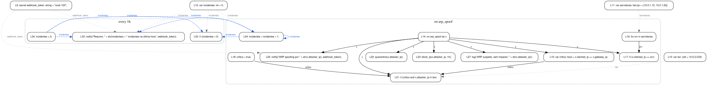

# Sentinela: análise estática

**Parte II, tarefa 2.** Implementação em [`analise.py`](analise.py), testes em [`test_analise.py`](test_analise.py), programas de demonstração em [`testes_analise/`](testes_analise/), grafos de dependências de dados em [`dfg/`](dfg/).

## 1. Objetivo

A gramática de atributos (Parte I) já garante que um playbook está **bem formado**: nomes declarados, tipos certos, segredos que não fogem. Mas olha para cada construção **isoladamente** e não sabe **por que ordem** as instruções correm, nem que o estado **persiste** de uma execução para a seguinte. Há perguntas importantes para quem escreve um playbook que só se respondem seguindo o fluxo pelo CFG da tarefa 1:

| Pergunta | Análise | Achado |
|---|---|---|
| Há valores escritos que **nunca chegam a ser lidos**? De onde vem o valor que cada instrução lê? | definições que chegam (*reaching definitions*) → **DFG** | **D01** atribuição morta |
| Há condições que, dados os valores **possíveis** das variáveis, são **sempre** verdadeiras ou **sempre** falsas (e, portanto, código que nunca corre)? | **intervalos** (interpretação abstrata) | **I01** sempre verdadeira, **I02** sempre falsa |
| Um IP que vem de um alerta (e que quem ataca controla) pode chegar a `block_ip` ou `quarantine` **sem** ter sido comparado com uma lista ou rede de confiança? | **validação de alvos** (domínio próprio da Sentinela) | **V01** alvo não validado |

A terceira é a análise **específica do domínio**. Os campos de um alerta são escritos por quem ataca: um IP de origem pode ser falsificado. Se um playbook bloqueia "o IP de onde veio o ataque" sem confirmar que não é, por exemplo, o *gateway* ou um servidor interno, um atacante pode usá-lo para que **a própria defesa desligue a rede** (*self-inflicted DoS*). O catálogo da Parte I dizia que "um playbook bloqueia um IP legítimo" era impossível de apanhar antes da execução ([`CATALOGO_ERROS.md`](CATALOGO_ERROS.md), §6); a análise V01 apanha a causa mais comum.

Os achados são **avisos para o analista**, como os `W…` da Parte I: não impedem a ativação.

## 2. Abordagem: um motor de fluxo de dados e três domínios

Como no notebook 8, o **domínio** (o que se calcula) está separado do **percurso do grafo** e do cálculo do **ponto fixo**. A classe `Analise` define o domínio:

| Operação | Para quê |
|---|---|
| `inicial(g)` | estado à entrada do nó *início* (ativação) |
| `juntar(a, b)` | junção ⊔ nos pontos onde os caminhos se encontram |
| `alargar(a, b)` | alargamento ∇ nos nós onde os ciclos fecham (só é preciso nos intervalos) |
| `transferir(n, instr, s)` | efeito de uma instrução (`F#` no notebook) |
| `refinar(instr, valor, s)` | o que se fica a saber ao seguir a aresta `verdadeiro` ou `falso` de um `if` |
| `restringir(s, estado)` | fim de um handler: as variáveis locais morrem, só o estado do playbook passa ao despacho |

`resolver(g, analise)` calcula, por **lista de trabalho**, o estado abstrato à entrada e à saída de cada nó do CFG de instruções. Um estado `None` é o ⊥: o ponto é **inalcançável**. Três pormenores vêm diretamente do modelo da Sentinela:

1. **As arestas de serviço contam.** O CFG tem o ciclo *despacho → handler → despacho*: o que um handler escreve no estado chega às execuções seguintes, dele ou de outro handler. Uma análise que só visse cada handler isolado estaria errada: em `04_arp_spoofing`, `incidentes` é incrementado em `on arp_spoof` e lido em `every 1h`.
2. **Cada execução de um handler começa limpa**: na aresta *fim → despacho* esquece-se tudo o que não é estado do playbook (`restringir`); na entrada de um `on X as a` o alerta é novo, por isso os campos `a.…` voltam a "não validado".
3. **Os ciclos (`for` e despacho) obrigam a um ponto fixo.** Nos domínios finitos (conjuntos de definições, três níveis de validação) a iteração termina sozinha. Nos intervalos, que têm cadeias infinitas, usa-se **alargamento** a partir da 3.ª visita e, no fim, duas passagens de **estreitamento** (sem ∇) que recuperam alguma precisão.

### Alterações ao CFG da tarefa 1

Para as análises, [`cfg.py`](cfg.py) passou a guardar em cada `Instrucao` a **árvore** da expressão (valor, condição ou lista do `for`), os **argumentos** das ações e os **nomes visíveis** naquele ponto. Passou também a resolver os **scopes**: uma variável que esconde outra de um scope exterior (aviso W03) fica com o nome único `nome@L<linha>` nos `defs`/`uses`, para que as duas não se misturem. Nada mais mudou: os testes da tarefa 1 continuam a passar.

## 3. As três análises

### 3.1 Definições que chegam, DFG e atribuições mortas (D01)

- **Domínio:** conjuntos de pares `(variável, nó que a definiu)`; junção = união; análise **para a frente** e ***may*** (basta um caminho).
- **Transferência:** uma instrução que define `v` mata as outras definições de `v` e gera a sua. O alias de um `on` e a variável de um `for` também são definições.
- **DFG:** para cada instrução que lê `v`, uma aresta de cada definição de `v` que lá chega. Cada aresta diz **de onde vem o valor**: da *ativação* (declaração do estado, pontilhado), da *mesma execução* (contínuo) ou de uma **execução anterior** (tracejado azul, só chega através do despacho).
- **D01:** uma declaração ou atribuição sem nenhuma aresta de saída no DFG. As declarações de variáveis que nunca são lidas já são o aviso W02 da GA e não se repetem.



No DFG de `04_arp_spoofing` vê-se o que o CFG sozinho não mostra: `if (incidentes > 0)` (L32) lê valores vindos de **três** sítios, a declaração (L12), o `incidentes + 1` do outro handler (L24) e o `incidentes = 0` do próprio `every` numa execução anterior (L34). E `incidentes = incidentes + 1` depende de **si próprio**.

### 3.2 Intervalos: condições sempre verdadeiras ou sempre falsas (I01, I02)

É o domínio de intervalos do notebook 8, aplicado à Sentinela:

- **Valores:** `[lo, hi]` para `int` e `duration` (em segundos), um subconjunto de `{true, false}` para `bool`, e ⊤ para o resto. `count(...)` e `len(...)` valem `[0, +∞]`; um campo de alerta é ⊤.
- **Transferência:** `+` e `-` sobre intervalos; comparações devolvem os valores lógicos **possíveis** (`[0, 3] > 5` só pode ser `false`).
- **Refinamento nas arestas do `if`:** `x < e`, `x >= e`, `x == e`, … restringem o intervalo de `x` em cada ramo; `and`, `or` e `not` respeitam o curto-circuito (no ramo falso de `a and b`, ou `a` foi falso, ou `a` foi verdadeiro e `b` falso). Se a restrição dá um intervalo vazio, o ramo é ⊥.
- **Alargamento com limiares** (como no analisador Astrée): um limite que cresce não salta logo para ±∞, passa para a constante seguinte do programa. É o que deixa provar que um contador `if (nivel < 3) { nivel = nivel + 1; }` fica em `[0, 3]` **entre execuções**.
- **I01 / I02:** uma condição alcançável cujo único valor possível é `true` / `false`. A mensagem diz que linhas nunca correm. Condições sem variáveis (`if (true)`) já são o aviso W05 da GA.

Com `--detalhe`, o despacho mostra o **invariante do estado** (o que é verdade sobre as variáveis do playbook entre quaisquer duas execuções), por exemplo `nivel ∈ [0, 3]`.

### 3.3 Validação dos alvos das ações destrutivas (V01)

- **Valores:** três níveis, `confiável ⊑ validado ⊑ não validado`. É **confiável** o que não depende de nenhum alerta (literais, estado inicial, `count`, `len`); é **não validado** o que vem de um campo de alerta; um valor calculado tem o pior nível dos seus operandos. A variável de um `for` tem o nível da lista.
- **Junção = máximo:** é uma análise ***must***: um valor só está validado se o estiver em **todos** os caminhos.
- **Validação (refinamento nas arestas do `if`):** `x in R`, `x == R` ou `x != R`, com `R` **confiável**, valida `x`, desde que se saiba que o teste foi **avaliado e decidiu** o caminho. No ramo verdadeiro de `a or b` não se sabe se `b` foi testado, por isso só fica validado o que for validado pelos dois lados. Comparar dois campos do alerta (`x.claimed_ip == x.gateway_ip`) não valida nada: são ambos controlados por quem ataca.
- **Fluxo pelo estado:** se um handler guarda um IP do alerta numa variável do playbook, o valor chega a **todos** os handlers como não validado (`V01_estado_entre_handlers.snt`).
- **V01:** `block_ip` ou `quarantine` cujo 1.º argumento é não validado.

É mais forte do que o aviso W01 da GA, que só vê se a ação está **dentro de algum** `if`: em `01_port_scan` a ação está dentro de um `if`, mas o `if` testa a **porta**, não o **IP** que é bloqueado.

## 4. Resultados

### 4.1 Casos práticos

```
$ python analise.py exemplos/*.snt
! exemplos/01_port_scan.snt: 1 achado(s)
    linha 12: V01: o alvo de block_ip (s.src_ip) vem do alerta e, em pelo menos um caminho, não é comparado com nenhuma lista ou rede de confiança
✔ exemplos/02_brute_force_ssh.snt: 0 achado(s)
✔ exemplos/03_syn_flood.snt: 0 achado(s)
✔ exemplos/04_arp_spoofing.snt: 0 achado(s)
```

| Playbook | Arestas do DFG (ativação / mesma execução / execução anterior) | Achados | Leitura |
|---|:-:|---|---|
| `01_port_scan` | 1 / 4 / 0 | **V01** L12 | qualquer IP que faça scan a uma porta sensível é bloqueado, **mesmo** que seja interno: a GA aceitava-o sem avisos |
| `02_brute_force_ssh` | 2 / 5 / 0 | — | `not (a.src_ip in rede_interna)` valida o alvo antes do `block_ip` |
| `03_syn_flood` | 2 / 8 / 0 | — | `mitigados ∈ [0, +∞]` depois do `for` (o alargamento fecha o ciclo); `rate_limit` não é destrutiva |
| `04_arp_spoofing` | 7 / 10 / 6 | — | `x.attacker_ip in lan` valida o alvo; `incidentes ∈ [0, +∞]` no despacho e `[1, +∞]` dentro de `if (incidentes > 0)` |

Para corrigir `01`, basta testar também o IP, como em `02`: `if (s.dest_port in portas_sensiveis and not (s.src_ip in rede_interna))`.

Excerto de `python analise.py --detalhe exemplos/04_arp_spoofing.snt` (estado antes de cada instrução):

```
  despacho (invariante do estado entre execuções): incidentes ∈ [0, +∞]
  L21  if (critico and x.attacker_ip in lan)              critico∈{false, true}  | critico:não validado
  L22  quarantine(x.attacker_ip);                           | x.attacker_ip:validado
  L23  block_ip(x.attacker_ip, 1h);                         | x.attacker_ip:validado
  L32  if (incidentes > 0)                                incidentes∈[0, +∞]
  L33  notify("Resumo: " + str(incidentes) + " …", webhook_token); incidentes∈[1, +∞]
```

### 4.2 Programas de demonstração

[`testes_analise/`](testes_analise/) tem um programa por situação, com `# expect: CÓDIGO` em cada linha que tem de ser assinalada. Todos são aceites pela GA **sem avisos**: são problemas que só a análise de fluxo vê.

| Programa | Achado | O que mostra |
|---|---|---|
| `D01_atribuicao_morta` | D01 L10 | o valor inicial de `msg` é substituído nos dois ramos do `if/else` |
| `D01_estado_reposto` | D01 L8, L11 | `ultimo` é escrito no `on` e reposto no `every` sem ser lido entretanto (**entre execuções**) |
| `I01_condicao_sempre_verdadeira` | I01 L10 | `count(...) >= 0`: o `else` nunca corre |
| `I02_nivel_impossivel` | I02 L13 | o nível de escalada é estado persistente e fica sempre em `[0, 3]`: `nivel > 3` nunca é verdade |
| `V01_alvo_nao_validado` | V01 L11 | a condição testa a porta, não o IP bloqueado |
| `V01_estado_entre_handlers` | V01 L17 | o IP passa pelo estado de um handler para o outro |
| `V01_so_num_ramo` | V01 L11 | `a.urgente or not (a.src in rede)`: se `urgente`, a rede não é testada |
| `OK_validado` | — | validação nos dois ramos, através de uma variável local, e estado lido antes de ser reposto |

## 5. Como se verifica

[`test_analise.py`](test_analise.py):

- cada programa de `testes_analise/` dá **exatamente** os achados marcados, e os casos práticos dão só o V01 de `01`;
- as três análises **terminam** e chegam ao despacho em todos os playbooks válidos (casos práticos, testes `W…` e demonstrações);
- casos concretos: as arestas "execução anterior" de `incidentes` em `04`; o *shadowing* de `W03` não mistura as duas variáveis `limite`; o contador de `I02` fica em `[0, 3]`; o `for` de `03` alarga `mitigados` para `[0, +∞]`; o refinamento dá `[1, +∞]` dentro de `if (incidentes > 0)`; um alerta novo não herda validações do anterior; comparar dois campos não valida.

## 6. Uso

```bash
python analise.py exemplos/*.snt                  # achados das três análises
python analise.py --detalhe exemplos/04_arp_spoofing.snt   # estado abstrato em cada instrução
python analise.py --dfg exemplos/*.snt            # dfg/<nome>.dot e .svg (o .svg precisa do Graphviz)
pytest -q test_analise.py
```

## 7. Pressupostos e limitações

As análises são **sobre-aproximações** (notebook 8, §8.3): consideram todos os caminhos do CFG, mesmo os que nunca acontecem. Isto tem consequências diferentes em cada uma:

- **Correção.** I01/I02 só aparecem quando a condição é constante em **todos** os estados possíveis, por isso não há falsos positivos (dentro do modelo). D01 e V01 podem ter **falsos positivos**: um caminho do CFG que nunca acontece na prática pode "salvar" uma definição ou "estragar" uma validação.
- **Sem sensibilidade ao caminho.** As definições que chegam não sabem que, logo depois de `incidentes = 0`, a condição `incidentes > 0` é falsa: no DFG de `04` aparece uma aresta de L34 para L33 que nunca é percorrida. Os intervalos sabem-no, mas cada análise corre sozinha.
- **Intervalos não relacionais.** Não se guardam relações entre variáveis (`x < y`); só o intervalo de cada uma. O alargamento pode perder precisão quando a constante que limita um contador não aparece no programa.
- **Validação não vê a polaridade.** `if (s.src in protegidos) { block_ip(s.src, 1h); }` bloqueia exatamente os IPs protegidos, e conta como validado: a análise garante que o analista **comparou** o alvo com uma referência de confiança, não que a decisão está certa. Também não sabe se a referência é a certa (`s.src != 0.0.0.0` conta como validação).
- **Modelo de eventos.** O despacho representa **qualquer** ordem e número de eventos, incluindo nenhum; não se sabe que um `every 1h` corre de hora a hora, nem com que frequência chega cada alerta.
- **Biblioteca.** `count` e `len` são modelados só por `[0, +∞]`; as ações não têm efeito sobre o estado da Sentinela.
