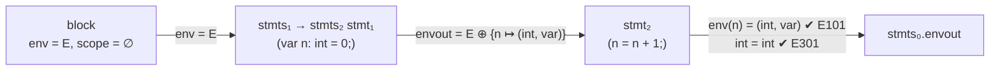

# Sentinela: especificação completa da linguagem

Versão 2.0 · Tarefas 2 e 3 do guião.

A linguagem está definida **num só ficheiro**, `sentinela.ag`: a gramática independente de contexto, os atributos, as regras de cálculo e as condições de contexto, no formato do LarkAG usado nas aulas. Este documento explica esse ficheiro em notação matemática.

| Peça | Onde |
|---|---|
| Especificação léxica | secção 1 · terminais no fim de `sentinela.ag` |
| Especificação sintática (GIC, BNF P1–P55) | secção 2 · produções de `sentinela.ag` |
| Gramática de atributos: declaração dos atributos | secção 3 · `SA(...)` / `IA(...)` no início de `sentinela.ag` |
| Gramática de atributos: regras por produção | secção 4 · blocos `ER { }` e `CC { }` de `sentinela.ag` |
| Processador | `sentinela.py`: gera o parser e o avaliador a partir de `sentinela.ag` |

---

## 1. Especificação léxica

| Token | Expressão regular / literais | Exemplos | Notas |
|---|---|---|---|
| Palavras reservadas | `alert playbook on as every var secret if else for in not and or list int bool string ip cidr duration true false` | `playbook`, `every` | não podem ser usadas como identificadores |
| `NAME` | `[a-zA-Z_][a-zA-Z0-9_]*` | `src_ip`, `limite` | identificadores |
| `INT` | `\d+` | `5432` | |
| `STRING` | `"[^"]*"` | `"Scan bloqueado"` | sem sequências de escape |
| `IP` (prioridade 4) | `\d{1,3}(\.\d{1,3}){3}` | `10.0.0.5` | a validade dos octetos é **semântica** (E701) |
| `CIDR` (prioridade 5) | `\d{1,3}(\.\d{1,3}){3}/\d{1,2}` | `10.0.0.0/8` | a validade do prefixo é **semântica** (E702) |
| `DURATION` (prioridade 3) | `\d+(s\|m\|h)` | `30s`, `10m`, `24h` | "maior que zero" é **semântico** (E703) |
| `BOOL` (prioridade 2) | `true \| false` | | |
| Operadores | `== != < > <= >= in + - . ,` | | |
| Pontuação | `{ } ( ) [ ] < > : ; =` | | |
| Comentários | `#[^\n]*` | `# fácil` | ignorados |
| Espaços | espaços, tabs, mudanças de linha | | ignorados |

As **prioridades** resolvem os conflitos léxicos entre literais de rede: `10.0.0.0/8` tem de ser **um** `CIDR` e não `IP` seguido de outra coisa; `24h` tem de ser **uma** `DURATION` e não `INT` seguido de `NAME`.

---

## 2. Especificação sintática (GIC)

### 2.1 Gramática em BNF

As listas (de alertas, campos, declarações, handlers, instruções e argumentos) são escritas com **recursão à esquerda**, como `decls → decls decl` nas aulas. É esta forma que permite passar o ambiente (`env`) de uma declaração para a seguinte.

```
P1   start      → alerts playbook
P2   alerts     → alerts alert
P3   alerts     → ε
P4   alert      → "alert" NAME "{" fields "}"
P5   fields     → fields field
P6   fields     → ε
P7   field      → NAME ":" datatype ";"
P8   datatype   → "int" | "bool" | "string" | "ip" | "cidr" | "duration"
P9   datatype   → "list" "<" datatype ">"

P10  playbook   → "playbook" NAME "{" statedecls handlers "}"
P11  statedecls → statedecls vardecl
P12  statedecls → ε
P13  handlers   → handlers handler
P14  handlers   → handler
P15  handler    → "on" ident "as" ident block
P16  handler    → "every" DURATION block
P17  ident      → NAME

P18  block      → "{" stmts "}"
P19  stmts      → stmts stmt
P20  stmts      → ε
P21  vardecl    → "var" NAME ":" datatype "=" expr ";"
P22  vardecl    → "secret" NAME ":" datatype "=" expr ";"
P23  stmt       → vardecl
P24  stmt       → NAME "=" expr ";"
P25  stmt       → "if" "(" expr ")" block
P26  stmt       → "if" "(" expr ")" block "else" block
P27  stmt       → "for" NAME "in" expr block
P28  stmt       → callee "(" args ")" ";"
P29  stmt       → callee "(" ")" ";"
P30  callee     → NAME
P31  args       → args "," expr
P32  args       → expr

P33  expr       → expr "or" andexpr
P34  expr       → andexpr
P35  andexpr    → andexpr "and" notexpr
P36  andexpr    → notexpr
P37  notexpr    → "not" notexpr
P38  notexpr    → relexpr
P39  relexpr    → addexpr RELOP addexpr              RELOP ∈ { == != < > <= >= }
P40  relexpr    → addexpr "in" addexpr
P41  relexpr    → addexpr
P42  addexpr    → addexpr "+" accessexpr
P43  addexpr    → addexpr "-" accessexpr
P44  addexpr    → accessexpr
P45  accessexpr → accessexpr "." NAME
P46  accessexpr → primary
P47  primary    → NAME
P48  primary    → callee "(" args ")"
P49  primary    → callee "(" ")"
P50  primary    → "(" expr ")"
P51  primary    → "[" items "]"
P52  primary    → "[" "]"
P53  primary    → INT | STRING | IP | CIDR | DURATION | BOOL
P54  items      → items "," expr
P55  items      → expr
```

### 2.2 Onde está a gramática

A gramática está escrita **uma só vez**, em `sentinela.ag`, no formato do LarkAG: cada produção tem as suas regras de cálculo (ER) e condições de contexto (CC). O LarkAG extrai daí a GIC (as produções desta secção) e o Lark gera o parser **LALR(1)**. As produções têm a mesma numeração (P1 a P55) no ficheiro e neste documento.

Dois não-terminais existem só por causa do LarkAG, que não deixa indexar terminais (escrever `NAME[2]`):

- `ident` (P17) dá nome a cada um dos dois `NAME` de `on NAME as NAME`;
- `callee` (P30) é o nome da ação ou da função chamada, e guarda a sua assinatura.

### 2.3 Propriedades da gramática

| Propriedade | Como se garante |
|---|---|
| **Sem ambiguidade** | o Lark constrói o parser **LALR(1) sem conflitos** (há um teste para isso); uma gramática LALR(1) é sempre não ambígua: cada programa tem uma única árvore de derivação |
| **Palavras reservadas** | o lexer do Lark dá prioridade às palavras da linguagem (`not`, `in`, `int`...) sobre `NAME`, por isso não podem ser usadas como identificadores |
| **Precedência** | por estratificação, da menor para a maior: `or` < `and` < `not` < comparações / `in` < `+ -` < `.` |
| **Associatividade** | `or`, `and`, `+`, `-` e `.` à esquerda (recursão à esquerda); comparações não associativas (`a < b < c` é erro de sintaxe) |
| **Sem *dangling else*** | os blocos levam sempre `{ }` |
| **Tamanho** | 25 não-terminais, 46 terminais, 65 produções (métricas e avaliação em `QUALIDADE.md`) |

---

## 3. Gramática de atributos: declaração dos atributos

Esta secção é a **chave de leitura da semântica**. Para cada símbolo declara-se que atributos tem, se são herdados (↓, vêm do pai ou dos irmãos à esquerda) ou sintetizados (↑, calculados a partir dos filhos) e em que domínio tomam valores. Só com estas declarações já se percebe **que regras a linguagem tem** (secção 3.3); a secção 4 diz **como** cada atributo é calculado. O início de `sentinela.ag` tem exatamente estas declarações, no formato `SA(...)` / `IA(...)` do LarkAG.

### 3.1 Domínios semânticos

| Domínio | Definição | Leitura |
|---|---|---|
| `Nome` | identificadores (`NAME`) | |
| `Tipo` | `{int, bool, string, ip, cidr, duration}` ∪ `{list<T> ∣ T ∈ Tipo}` ∪ `{A:n ∣ n é um alerta}` | `A:n` é o tipo do alias de um alerta `n` (o `a` de `on n as a`) |
| `Espécie` | `{var, secret, loop, alias}` | o que um nome é: variável, segredo, variável do `for` ou alias de um alerta |
| `Env` | `Nome ⇀ Tipo × Espécie` | ambiente: os nomes visíveis, com o tipo e a espécie de cada um |
| `Scope` | `℘(Nome)` | nomes declarados num scope |
| `FieldTab` | `Nome ⇀ Tipo` | campos de um alerta e os seus tipos |
| `AlertTab` | `Nome ⇀ FieldTab` | todos os alertas declarados |
| `Sig` | `(params : [℘(Tipo)], min : ℕ, returns : Tipo ∪ {⊥}, destructive : 𝔹)` | assinatura de uma ação ou função da biblioteca (secção 3.4) |
| `Level` | `{top, inner}` | a declaração está no estado do playbook (`top`) ou dentro de um bloco (`inner`) |
| `Const` | texto de uma constante `true`, `false` ou `"…"`, ou `""` se não for constante | |
| `Warning` | `(código, linha, mensagem)` | um aviso, por exemplo `(W02, 9, "'x' é declarada mas nunca é usada")` |

A notação `e ⊕ {n ↦ v}` acrescenta (ou substitui) `n` no ambiente `e`. Como a avaliação **pára no primeiro erro**, nunca é preciso continuar com um tipo "desconhecido".

### 3.2 Declaração dos atributos

```
A(start)      = { (warnings,  ↑, [Warning]) }

A(alerts)     = { (table,     ↑, AlertTab), (lines,    ↑, Nome ⇀ ℕ) }
A(alert)      = { (seen,      ↓, ℘(Nome)),
                  (name,      ↑, Nome),     (fieldtab, ↑, FieldTab),  (line, ↑, ℕ) }
A(fields)     = { (table,     ↑, FieldTab) }
A(field)      = { (seen,      ↓, ℘(Nome)),
                  (name,      ↑, Nome),     (type,     ↑, Tipo) }
A(datatype)   = { (type,      ↑, Tipo) }

A(playbook)   = { (alerttab,  ↓, AlertTab),
                  (handled,   ↑, ℘(Nome)),  (warnings, ↑, [Warning]) }
A(statedecls) = { (env,       ↓, Env),      (alerttab, ↓, AlertTab),
                  (envout,    ↑, Env),      (declared, ↑, Nome ⇀ ℕ),
                  (used,      ↑, ℘(Nome)),  (warnings, ↑, [Warning]) }
A(handlers)   = { (env,       ↓, Env),      (alerttab, ↓, AlertTab),
                  (handled,   ↑, ℘(Nome)),  (used,     ↑, ℘(Nome)),
                  (warnings,  ↑, [Warning]) }
A(handler)    = { (env,       ↓, Env),      (alerttab, ↓, AlertTab),
                  (seen,      ↓, ℘(Nome)),
                  (target,    ↑, Nome),     (used,     ↑, ℘(Nome)),
                  (warnings,  ↑, [Warning]) }
A(ident)      = { (name,      ↑, Nome),     (line,     ↑, ℕ) }

A(block)      = { (env,       ↓, Env),      (scope,    ↓, Scope),
                  (alerttab,  ↓, AlertTab), (guarded,  ↓, 𝔹),
                  (used,      ↑, ℘(Nome)),  (warnings, ↑, [Warning]) }
A(stmts)      = A(stmt) =
                { (env,       ↓, Env),      (scope,    ↓, Scope),
                  (alerttab,  ↓, AlertTab), (guarded,  ↓, 𝔹),
                  (envout,    ↑, Env),      (scopeout, ↑, Scope),
                  (declared,  ↑, Nome ⇀ ℕ), (used,     ↑, ℘(Nome)),
                  (warnings,  ↑, [Warning]) }
A(vardecl)    = { (env,       ↓, Env),      (scope,    ↓, Scope),
                  (alerttab,  ↓, AlertTab), (level,    ↓, Level),
                  (envout,    ↑, Env),      (scopeout, ↑, Scope),
                  (declared,  ↑, Nome ⇀ ℕ), (used,     ↑, ℘(Nome)),
                  (warnings,  ↑, [Warning]) }

A(callee)     = { (name,      ↑, Nome),     (signature, ↑, Sig ∪ {⊥}), (line, ↑, ℕ) }
A(args)       = { (env,       ↓, Env),      (alerttab, ↓, AlertTab),
                  (types,     ↑, [Tipo]),   (secrets,  ↑, [𝔹]),
                  (consts,    ↑, [Const]),  (used,     ↑, ℘(Nome)) }
A(items)      = { (env,       ↓, Env),      (alerttab, ↓, AlertTab),
                  (types,     ↑, [Tipo]),   (secret,   ↑, 𝔹),
                  (used,      ↑, ℘(Nome)) }

A(X)          = { (env,       ↓, Env),      (alerttab, ↓, AlertTab),
                  (type,      ↑, Tipo),     (secret,   ↑, 𝔹),
                  (const,     ↑, Const),    (used,     ↑, ℘(Nome)) }
                para X ∈ {expr, andexpr, notexpr, relexpr, addexpr, accessexpr, primary}
```

Resumo por atributo:

| Atributo | ↓/↑ | Domínio | Significado | Erros e avisos |
|---|---|---|---|---|
| `alerttab` | ↓ | `AlertTab` | alertas declarados e os seus campos | E201, E203, E204 |
| `env` / `envout` | ↓ / ↑ | `Env` | nomes visíveis antes / depois de um símbolo | E101, E301, E501, E502, E601, E602 |
| `scope` / `scopeout` | ↓ / ↑ | `Scope` | nomes já declarados no scope atual | E102, W03 |
| `seen` | ↓ | `℘(Nome)` | alertas, campos ou alertas tratados que já apareceram antes (à esquerda) | E103, E104, E202 |
| `level` | ↓ | `Level` | a declaração está no estado do playbook ou num bloco? | E105 |
| `guarded` | ↓ | `𝔹` | a instrução está dentro de um `if`/`else`? | W01 |
| `table`, `fieldtab`, `name` | ↑ | | tabelas e nomes construídos pelas declarações | |
| `type` | ↑ | `Tipo` | tipo de um valor | E301–E310, E401–E405 |
| `secret`, `secrets` | ↑ | `𝔹`, `[𝔹]` | o valor (ou cada argumento) depende de um segredo? | E601–E603 |
| `signature`, `types` | ↑ | `Sig`, `[Tipo]` | assinatura da ação chamada; tipos dos argumentos | E401–E405, W01 |
| `const`, `consts` | ↑ | `Const`, `[Const]` | texto de uma constante | W05, W06 |
| `handled`, `target` | ↑ | `℘(Nome)`, `Nome` | alertas que já têm um `on` | E202, W04 |
| `declared`, `used` | ↑ | `Nome ⇀ ℕ`, `℘(Nome)` | nomes declarados (com a linha) / nomes lidos | W02 |
| `line`, `lines` | ↑ | `ℕ` | linha de um nome, para os avisos | todos os avisos |
| `warnings` | ↑ | `[Warning]` | avisos; os **erros** são condições de contexto | W01–W06 |

### 3.3 O que as declarações dizem sobre a semântica

Sem olhar para nenhuma regra de cálculo, as declarações acima já revelam as regras da linguagem:

| Padrão nas declarações | Regra da linguagem que revela |
|---|---|
| `env` é **herdado** em todas as instruções e expressões, e as sequências de declarações e instruções (`stmts`, `stmt`, `vardecl`, `statedecls`) sintetizam um `envout` que passa à seguinte | **scopes estáticos** e **declarar antes de usar**: o ambiente desce na árvore e cresce da esquerda para a direita |
| `scope` é **herdado** e cada `block` recebe o seu próprio `scope` | **não se pode redeclarar no mesmo bloco**, mas um bloco interior pode reutilizar um nome (*shadowing*, com aviso) |
| `Env` guarda uma **`Espécie`** além do tipo | um nome não é só um tipo: segredos, variáveis do `for` e aliases de alertas têm **regras próprias** (não se alteram, não se expõem) |
| `type` é **sintetizado** nas expressões e não há tipo herdado | **tipagem de baixo para cima**: o tipo de uma expressão depende só das suas partes; os tipos das variáveis vêm sempre de uma declaração explícita (`nome: tipo`) |
| `Tipo` tem `ip`, `cidr`, `duration` e `A:n` | os conceitos de **rede e de alerta são tipos** da linguagem, verificados como `int` ou `bool` |
| `secret` é **sintetizado** nas expressões | **fluxo de informação**: uma expressão que usa um segredo fica secreta, e é seguida até onde for usada |
| `seen` é **herdado** em `alert`, `field` e `handler` | **unicidade**: cada alerta, cada campo de um alerta e cada `on` só aparece uma vez |
| `alerttab` é **herdado** desde `start` por toda a árvore | os alertas são **globais**: declaram-se antes do playbook e são visíveis em todo o lado |
| `level` é **herdado** só em `vardecl` | a **posição** de uma declaração importa: os segredos só podem existir no estado do playbook |
| `guarded` é **herdado** nas instruções | o **contexto condicional** importa: uma ação destrutiva fora de um `if` é assinalada |
| `declared` e `used` são **sintetizados** | variáveis declaradas e **nunca lidas** são assinaladas |
| `const` é **sintetizado** nas expressões | **constantes** escritas no programa (`if (true)`, `log("")`) são assinaladas |
| `warnings` é um atributo, mas os erros não | há **dois níveis de gravidade**: os erros (condições de contexto) impedem a ativação, os avisos não |

### 3.4 Funções auxiliares e biblioteca

| Função | Definição |
|---|---|
| `islist(t)` | `t` é da forma `list<T>`; `elem(list<T>) = T` |
| `isalert(t)` | `t` é da forma `A:n`; `fieldsof(A:n) = alerttab(n)` |
| `SIG(f)` | assinatura `s = (params, min, returns, destructive)` da tabela abaixo; `⊥` se `f` não existe |
| `accepts(ts, ps)` | cada tipo de `ts` pertence ao conjunto correspondente de `ps` (`*` aceita tudo, `L` aceita qualquer lista) |
| `leaks(f, secrets)` | existe `i` com `secrets[i]` verdadeiro, exceto `f = notify ∧ i = 2` (a credencial) |
| `validip(x)` | os 4 octetos de `x` estão entre 0 e 255 |
| `prefix(x)` | o prefixo de um CIDR `x` (número depois de `/`) |
| `dur(x)` | o valor numérico de uma duração `x` |
| `linha(x)` | a linha do token ou do nó `x` |

| `f` | parâmetros | mín. | retorno | destrutiva |
|---|---|---|---|---|
| `block_ip` | `{ip, cidr}`, `{duration}` | 2 | — | sim |
| `unblock_ip` | `{ip, cidr}` | 1 | — | não |
| `quarantine` | `{ip}` | 1 | — | sim |
| `rate_limit` | `{ip}`, `{int}` | 2 | — | não |
| `log` | `{string}` | 1 | — | não |
| `notify` | `{string}`, `{string}` (credencial) | 1 | — | não |
| `count` | `{ip}`, `{duration}` | 2 | `int` | não |
| `len` | `{L}` | 1 | `int` | não |
| `str` | `{*}` | 1 | `string` | não |

---

## 4. Gramática de atributos: regras por produção

É a mesma informação de `sentinela.ag`, em notação matemática. **Convenções.** Os índices distinguem ocorrências do mesmo símbolo (`stmts₀` é o pai e `stmts₁` o filho). Quando nada é dito:

- os atributos **herdados** `env`, `scope`, `alerttab` e `guarded` passam do pai para os filhos sem alteração;
- `used` é a **união** dos dos filhos e `warnings` é a **concatenação** dos dos filhos;
- `const = ""` (só os literais `STRING` e `BOOL` e as produções unitárias o alteram).

A coluna **CC** tem as condições de contexto, pela ordem em que são avaliadas. A primeira que falhar dá o erro indicado e a avaliação pára.

### 4.1 Programa e alertas

| Prod. | Regras de cálculo (ER) | Condições de contexto (CC) |
|---|---|---|
| P1 | `playbook.alerttab = alerts.table`<br>`start.warnings = ordenados por linha (playbook.warnings ++ [W04(alerts.lines(a), a) ∣ a ∈ dom(alerts.table) ∖ playbook.handled])` | |
| P2 | `alert.seen = dom(alerts₁.table)`<br>`alerts₀.table = alerts₁.table ⊕ {alert.name ↦ alert.fieldtab}`<br>`alerts₀.lines = alerts₁.lines ⊕ {alert.name ↦ alert.line}` | |
| P3 | `alerts.table = {}`, `alerts.lines = {}` | |
| P4 | `alert.name = NAME`, `alert.line = linha(NAME)`<br>`alert.fieldtab = fields.table` | `NAME ∉ alert.seen` → **E103** |
| P5 | `field.seen = dom(fields₁.table)`<br>`fields₀.table = fields₁.table ⊕ {field.name ↦ field.type}` | |
| P6 | `fields.table = {}` | |
| P7 | `field.name = NAME`<br>`field.type = datatype.type` | `NAME ∉ field.seen` → **E104** |
| P8 | `datatype.type =` a palavra reservada (`int`, `bool`, ...) | |
| P9 | `datatype₀.type = list<datatype₁.type>` | |

### 4.2 Playbook e handlers

| Prod. | Regras de cálculo (ER) | Condições de contexto (CC) |
|---|---|---|
| P10 | `statedecls.env = {}`<br>`handlers.env = statedecls.envout`<br>`playbook.handled = handlers.handled`<br>`playbook.warnings = statedecls.warnings ++ handlers.warnings ++ [W02(n) ∣ n ∈ dom(statedecls.declared) ∖ (statedecls.used ∪ handlers.used)]` | |
| P11 | `statedecls₁.env = statedecls₀.env`<br>`vardecl.env = statedecls₁.envout`, `vardecl.scope = dom(statedecls₁.envout)`<br>`vardecl.level = top`<br>`statedecls₀.envout = vardecl.envout`<br>`statedecls₀.declared = statedecls₁.declared ⊕ vardecl.declared` | |
| P12 | `statedecls.envout = statedecls.env`, `statedecls.declared = {}` | |
| P13 | `handler.seen = handlers₁.handled`<br>`handlers₀.handled = handlers₁.handled ∪ {handler.target}` (exceto para `every`) | |
| P14 | `handler.seen = ∅`<br>`handlers.handled = {handler.target}` (exceto para `every`) | |
| P15 | `block.env = handler.env ⊕ {ident₂.name ↦ (A:ident₁.name, alias)}`<br>`block.scope = {ident₂.name}`, `block.guarded = false`<br>`handler.target = ident₁.name`<br>`handler.warnings = block.warnings ++ [W03(ident₂.name) ∣ ident₂.name ∈ dom(handler.env)]` | `ident₁.name ∈ dom(handler.alerttab)` → **E201**<br>`ident₁.name ∉ handler.seen` → **E202** |
| P16 | `block.scope = ∅`, `block.guarded = false`<br>`handler.target = ""` | `dur(DURATION) > 0` → **E703** |
| P17 | `ident.name = NAME`, `ident.line = linha(NAME)` | |

O handler `on` corre **sempre que chega** um alerta desse tipo e o handler `every` corre **periodicamente**. As variáveis de `statedecls` são o **estado persistente** do playbook: o seu valor mantém-se entre execuções dos handlers.

### 4.3 Blocos, declarações e instruções

| Prod. | Regras de cálculo (ER) | Condições de contexto (CC) |
|---|---|---|
| P18 | `stmts.env = block.env`, `stmts.scope = block.scope`, `stmts.guarded = block.guarded`<br>`block.warnings = stmts.warnings ++ [W02(n) ∣ n ∈ dom(stmts.declared) ∖ stmts.used]` | |
| P19 | `stmts₁.env = stmts₀.env`, `stmts₁.scope = stmts₀.scope`<br>`stmt.env = stmts₁.envout`, `stmt.scope = stmts₁.scopeout`<br>`stmts₀.envout = stmt.envout`, `stmts₀.scopeout = stmt.scopeout`<br>`stmts₀.declared = stmts₁.declared ⊕ stmt.declared` | |
| P20 | `stmts.envout = stmts.env`, `stmts.scopeout = stmts.scope`, `stmts.declared = {}` | |
| P21 | `vardecl.envout = vardecl.env ⊕ {NAME ↦ (datatype.type, var)}`<br>`vardecl.scopeout = vardecl.scope ∪ {NAME}`<br>`vardecl.declared = {NAME ↦ linha(NAME)}`<br>`vardecl.warnings = [W03(NAME) ∣ NAME ∈ dom(vardecl.env) ∖ vardecl.scope]` | `NAME ∉ vardecl.scope` → **E102**<br>`expr.type = datatype.type` → **E301**<br>`¬ expr.secret` → **E602** |
| P22 | igual a P21, com espécie `secret` e sem avisos | `vardecl.level = top` → **E105**<br>`NAME ∉ vardecl.scope` → **E102**<br>`expr.type = datatype.type` → **E301** |
| P23 | `vardecl.level = inner`<br>`stmt` recebe `envout`, `scopeout`, `declared` de `vardecl` | |
| P24 | `stmt.envout = stmt.env`, `stmt.scopeout = stmt.scope`, `stmt.declared = {}`<br>sendo `(t, k) = stmt.env(NAME)` | `NAME ∈ dom(stmt.env)` → **E101**<br>`k ≠ secret` → **E501**<br>`k ∉ {loop, alias}` → **E502**<br>`t = expr.type` → **E301**<br>`¬ expr.secret` → **E602** |
| P25 | `block.guarded = true`, `block.scope = ∅`<br>`stmt.envout = stmt.env`, `stmt.scopeout = stmt.scope`, `stmt.declared = {}`<br>`stmt.warnings = [W05 ∣ expr.const ∈ {true, false}] ++ block.warnings` | `expr.type = bool` → **E308**<br>`¬ expr.secret` → **E603** |
| P26 | igual a P25, para `block₁` e `block₂` | iguais a P25 |
| P27 | `block.env = stmt.env ⊕ {NAME ↦ (elem(expr.type), loop)}`<br>`block.scope = {NAME}`, `block.guarded = stmt.guarded`<br>`stmt.envout = stmt.env`, `stmt.scopeout = stmt.scope`, `stmt.declared = {}`<br>`stmt.warnings = [W03(NAME) ∣ NAME ∈ dom(stmt.env)] ++ block.warnings` | `islist(expr.type)` → **E309**<br>`¬ expr.secret` → **E603** |
| P28 | `stmt.envout = stmt.env`, `stmt.scopeout = stmt.scope`, `stmt.declared = {}`<br>sendo `s = callee.signature`<br>`stmt.warnings = [W01 ∣ s.destructive ∧ ¬ stmt.guarded] ++ [W06 ∣ callee.name ∈ {log, notify} ∧ args.consts₁ = ""]` | `s ≠ ⊥` → **E401**<br>`s.returns = ⊥` → **E404**<br>`s.min ≤ \|args.types\| ≤ \|s.params\|` → **E402**<br>`accepts(args.types, s.params)` → **E403**<br>`¬ leaks(callee.name, args.secrets)` → **E601** |
| P29 | igual a P28, sem argumentos e sem avisos | `s ≠ ⊥` → **E401**<br>`s.returns = ⊥` → **E404**<br>`s.min = 0` → **E402** |
| P30 | `callee.name = NAME`, `callee.line = linha(NAME)`<br>`callee.signature = SIG(NAME)` | |
| P31 | `args₀.types = args₁.types ++ [expr.type]`<br>`args₀.secrets = args₁.secrets ++ [expr.secret]`<br>`args₀.consts = args₁.consts ++ [expr.const]` | |
| P32 | `args.types = [expr.type]`, `args.secrets = [expr.secret]`, `args.consts = [expr.const]` | |

### 4.4 Expressões

| Prod. | Regras de cálculo (ER) | Condições de contexto (CC) |
|---|---|---|
| P33 | `expr₀.type = bool`<br>`expr₀.secret = expr₁.secret ∨ andexpr.secret` | `expr₁.type = bool ∧ andexpr.type = bool` → **E307** |
| P35 | igual a P33, para `and` | → **E307** |
| P37 | `notexpr₀.type = bool`, `notexpr₀.secret = notexpr₁.secret` | `notexpr₁.type = bool` → **E307** |
| P34, P36, P38, P41, P44, P46, P50 | **produções unitárias**: o pai copia `type`, `secret`, `const` e `used` do filho | |
| P39 | `relexpr.type = bool`<br>`relexpr.secret = addexpr₁.secret ∨ addexpr₂.secret` | se `RELOP ∈ {< > <= >=}`: `addexpr₁.type = addexpr₂.type ∈ {int, duration}` → **E304**<br>se `RELOP ∈ {== !=}`: `addexpr₁.type = addexpr₂.type ∧ ¬islist(addexpr₁.type) ∧ ¬isalert(addexpr₁.type)` → **E305** |
| P40 | `relexpr.type = bool`<br>`relexpr.secret = addexpr₁.secret ∨ addexpr₂.secret` | `addexpr₂.type = list<addexpr₁.type> ∨ (addexpr₁.type = ip ∧ addexpr₂.type = cidr)` → **E306** |
| P42 | `addexpr₀.type = accessexpr.type`<br>`addexpr₀.secret = addexpr₁.secret ∨ accessexpr.secret` | `addexpr₁.type = accessexpr.type ∈ {int, string, duration}` → **E302** |
| P43 | igual a P42 | `addexpr₁.type = accessexpr.type ∈ {int, duration}` → **E303** |
| P45 | `accessexpr₀.type = fieldsof(accessexpr₁.type)(NAME)`<br>`accessexpr₀.secret = accessexpr₁.secret` | `isalert(accessexpr₁.type)` → **E203**<br>`NAME ∈ dom(fieldsof(accessexpr₁.type))` → **E204** |
| P47 | `(primary.type, k) = primary.env(NAME)`<br>`primary.secret = (k = secret)`<br>`primary.used = {NAME}` | `NAME ∈ dom(primary.env)` → **E101** |
| P48 | `primary.type = callee.signature.returns`<br>`primary.secret = ∨ args.secrets` | `callee.signature ≠ ⊥` → **E401**<br>`callee.signature.returns ≠ ⊥` → **E405**<br>`s.min ≤ \|args.types\| ≤ \|s.params\|` → **E402**<br>`accepts(args.types, s.params)` → **E403** |
| P49 | igual a P48, sem argumentos | **E401**, **E405**, `s.min = 0` → **E402** |
| P51 | `primary.type = list<T>` com `{T} = set(items.types)`<br>`primary.secret = items.secret` | `\|set(items.types)\| = 1` → **E310** |
| P52 | — | `false` → **E310** (a lista vazia não tem tipo) |
| P53 | `primary.type` = `int`, `string`, `ip`, `cidr`, `duration` ou `bool`<br>`primary.secret = false`<br>se `STRING` ou `BOOL`: `primary.const` = o texto do literal | `IP`: `validip(IP)` → **E701**<br>`CIDR`: `validip(CIDR)` → **E701**, `prefix(CIDR) ≤ 32` → **E702**<br>`DURATION`: `dur(DURATION) > 0` → **E703** |
| P54, P55 | como P31 e P32, com `items` | |

---

## 5. Ordem de avaliação

A gramática é **L-atribuída**: todos os atributos herdados de um filho dependem apenas dos atributos herdados do pai e dos atributos sintetizados dos **irmãos à sua esquerda**. Exemplos:

- P1: `playbook.alerttab` vem de `alerts`, que está à esquerda;
- P10: `handlers.env` vem de `statedecls.envout`, à esquerda;
- P13: `handler.seen` vem de `handlers₁.handled`, à esquerda;
- P19: `stmt.env` vem de `stmts₁.envout`, à esquerda;
- P27: o tipo da variável do `for` vem de `expr.type`, à esquerda de `block`.

Por isso, **uma única travessia em profundidade, da esquerda para a direita**, avalia todos os atributos. O LarkAG calcula esta ordem automaticamente a partir das dependências e recusa gramáticas com dependências circulares.

Exemplo do fluxo do ambiente em `var n: int = 0; n = n + 1;` dentro de um bloco:



---

## 6. De cada código à produção e ao teste

| Código | Produções | Teste |
|---|---|---|
| E101 | P24, P47 | `testes/E101_nao_declarada.snt` |
| E102 | P21, P22 | `testes/E102_redeclaracao.snt` |
| E103, E104 | P4, P7 | `testes/E103_*.snt`, `testes/E104_*.snt` |
| E105 | P22 | `testes/E105_segredo_local.snt` |
| E201, E202 | P15 | `testes/E201_*.snt`, `testes/E202_*.snt` |
| E203, E204 | P45 | `testes/E203_*.snt`, `testes/E204_*.snt` |
| E301 | P21, P22, P24 | `testes/E301_tipo_declarado.snt` |
| E302 a E306 | P39 a P43 | `testes/E302_*.snt` … `testes/E306_*.snt` |
| E307 | P33, P35, P37 | `testes/E307_logico.snt` |
| E308, E309 | P25 a P27 | `testes/E308_*.snt`, `testes/E309_*.snt` |
| E310 | P51, P52 | `testes/E310_*.snt` (2) |
| E401 a E403 | P28, P29, P48, P49 | `testes/E401_*.snt` … `testes/E403_*.snt` |
| E404, E405 | P28/P29, P48/P49 | `testes/E404_*.snt`, `testes/E405_*.snt` |
| E501, E502 | P24 | `testes/E501_*.snt`, `testes/E502_*.snt` |
| E601 | P28 | `testes/E601_segredo_no_log.snt` |
| E602 | P21, P24 | `testes/E602_segredo_em_variavel.snt` |
| E603 | P25 a P27 | `testes/E603_segredo_na_condicao.snt` |
| E701 a E703 | P16, P53 | `testes/E701_*.snt` … `testes/E703_*.snt` |
| W01, W06 | P28 | `testes/W01_*.snt`, `testes/W06_*.snt` |
| W02 | P10, P18 | `testes/W02_variavel_nao_usada.snt` |
| W03 | P15, P21, P27 | `testes/W03_shadowing.snt` |
| W04 | P1 | `testes/W04_alerta_sem_on.snt` |
| W05 | P25, P26 | `testes/W05_condicao_constante.snt` |
