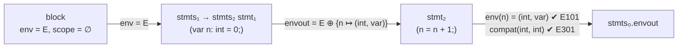

# Sentinela: especificação completa da linguagem

Versão 1.3 · Este documento é a **fonte de verdade** para as tarefas 2 e 3 do guião.

| Peça | Ficheiro | O que contém |
|---|---|---|
| Especificação léxica e sintática | `sentinela.lark` | gramática completa em Lark (LALR(1), sem conflitos) |
| Gramática de atributos **completa** | este documento, secções 3 e 4 | atributos, regras de cálculo (ER) e condições de contexto (CC) de todas as produções |
| **Exemplo** em LarkAG (uma parte da GA) | `sentinela_ag.py` | 42 condições de contexto executáveis (25 códigos de erro), no formato das aulas (EX04) |
| Implementação completa da GA | `verificador.py` | avalia todos os atributos e reporta todos os erros e avisos |

---

## 1. Especificação léxica

| Token | Expressão regular / literais | Exemplos | Notas |
|---|---|---|---|
| Palavras reservadas | `alert playbook on as every var secret if else for in not and or list int bool string ip cidr duration true false` | `playbook`, `every` | não podem ser usadas como identificadores |
| `NAME` | `[a-zA-Z_][a-zA-Z0-9_]*` | `src_ip`, `limite` | identificadores |
| `INT` | `\d+` | `5432` | |
| `STRING` | `"[^"]*"` | `"Scan bloqueado"` | sem sequências de escape |
| `IP` (prioridade 4) | `\d{1,3}(\.\d{1,3}){3}` | `10.0.0.5` | a validade dos octetos é **semântica** (E701) |
| `CIDR` (prioridade 5) | `\d{1,3}(\.\d{1,3}){3}/\d{1,2}` | `10.0.0.0/8` | a validade do prefixo é **semântica** (E702) |
| `DURATION` (prioridade 3) | `\d+(s\|m\|h)` | `30s`, `10m`, `24h` | "maior que zero" é **semântico** (E703) |
| `BOOL` (prioridade 2) | `true \| false` | | |
| Operadores | `== != < > <= >= in + - . ,` | | |
| Pontuação | `{ } ( ) [ ] < > : ; =` | | |
| Comentários | `#[^\n]*` | `# fácil` | ignorados |
| Espaços | espaços, tabs, mudanças de linha | | ignorados |

As **prioridades** resolvem os conflitos léxicos entre literais de rede: `10.0.0.0/8` tem de ser **um** `CIDR` e não `IP` seguido de outra coisa; `24h` tem de ser **uma** `DURATION` e não `INT` seguido de `NAME`.

---

## 2. Especificação sintática (GIC)

### 2.1 Gramática em BNF

É a gramática de `sentinela.lark` com as repetições (`X*`, `X+`, `[...]`) **expandidas em recursão à esquerda**. Esta forma é a necessária para passar o ambiente (`env`) de uma declaração para a seguinte na gramática de atributos, como no exemplo `decls → decls decl` das aulas.

```
P1   start      → alerts playbook
P2   alerts     → alerts alert
P3   alerts     → ε
P4   alert      → "alert" NAME "{" fields "}"
P5   fields     → fields field
P6   fields     → ε
P7   field      → NAME ":" datatype ";"
P8   datatype   → "int" | "bool" | "string" | "ip" | "cidr" | "duration"
P9   datatype   → "list" "<" datatype ">"

P10  playbook   → "playbook" NAME "{" statedecls handlers "}"
P11  statedecls → statedecls vardecl
P12  statedecls → ε
P13  handlers   → handlers handler
P14  handlers   → handler
P15  handler    → "on" ident "as" ident block
P16  handler    → "every" DURATION block
P17  ident      → NAME

P18  block      → "{" stmts "}"
P19  stmts      → stmts stmt
P20  stmts      → ε
P21  vardecl    → "var" NAME ":" datatype "=" expr ";"
P22  vardecl    → "secret" NAME ":" datatype "=" expr ";"
P23  stmt       → vardecl
P24  stmt       → NAME "=" expr ";"
P25  stmt       → "if" "(" expr ")" block
P26  stmt       → "if" "(" expr ")" block "else" block
P27  stmt       → "for" NAME "in" expr block
P28  stmt       → callee "(" args ")" ";"
P29  stmt       → callee "(" ")" ";"
P30  callee     → NAME
P31  args       → args "," expr
P32  args       → expr

P33  expr       → expr "or" andexpr
P34  expr       → andexpr
P35  andexpr    → andexpr "and" notexpr
P36  andexpr    → notexpr
P37  notexpr    → "not" notexpr
P38  notexpr    → relexpr
P39  relexpr    → addexpr RELOP addexpr              RELOP ∈ { == != < > <= >= }
P40  relexpr    → addexpr "in" addexpr
P41  relexpr    → addexpr
P42  addexpr    → addexpr "+" accessexpr
P43  addexpr    → addexpr "-" accessexpr
P44  addexpr    → accessexpr
P45  accessexpr → accessexpr "." NAME
P46  accessexpr → primary
P47  primary    → NAME
P48  primary    → callee "(" args ")"
P49  primary    → callee "(" ")"
P50  primary    → "(" expr ")"
P51  primary    → "[" items "]"
P52  primary    → "[" "]"
P53  primary    → INT | STRING | IP | CIDR | DURATION | BOOL
P54  items      → items "," expr
P55  items      → expr
```

### 2.2 Correspondência com `sentinela.lark`

Os nomes são **os mesmos** nos três ficheiros (`sentinela.lark`, este documento e `sentinela_ag.py`): em inglês, como as palavras reservadas da linguagem, em minúsculas e sem `_`. A única diferença é a notação: o `sentinela.lark` usa EBNF (repetições `*`, `+`, `[...]`), que o Lark aceita diretamente, e este documento usa BNF pura, que é a forma necessária para escrever as regras da gramática de atributos.

| BNF (este documento e LarkAG) | `sentinela.lark` (EBNF) |
|---|---|
| `alerts`, `fields`, `statedecls`, `handlers`, `stmts` | `alert*`, `field*`, `vardecl*`, `handler+`, `stmt*` |
| `handler` (P15, P16) | `handler` (nós `onhandler`, `everyhandler`) |
| `stmt` (P24 a P29) | `stmt` (nós `assign`, `ifstmt`, `forstmt`, `action`) |
| `args`, `items` | `[expr ("," expr)*]` |
| `callee`, `ident` | `NAME` (o Lark não precisa de os separar) |
| todos os outros | os mesmos nomes |

### 2.3 Propriedades da gramática

| Propriedade | Como se garante |
|---|---|
| **Sem ambiguidade** | o Lark constrói o parser LALR(1) sem conflitos; o Earley com `ambiguity="explicit"` não encontra nenhuma ambiguidade nos 23 ficheiros do corpus |
| **Precedência** | por estratificação, da menor para a maior: `or` < `and` < `not` < comparações / `in` < `+ -` < `.` |
| **Associatividade** | `or`, `and`, `+`, `-` e `.` à esquerda (recursão à esquerda); comparações não associativas (`a < b < c` é erro de sintaxe) |
| **Sem *dangling else*** | os blocos levam sempre `{ }` |
| **Tamanho** | BNF: 25 não-terminais, 46 terminais, 65 produções (métricas completas e avaliação em `QUALIDADE.md`) |

---

## 3. Gramática de atributos: atributos

### 3.1 Domínios

- **Tipos:** `int`, `bool`, `string`, `ip`, `cidr`, `duration`, `list<T>`, `A:n` (alias de um alerta `n`) e `⊥` (desconhecido; resulta de um erro já reportado e é compatível com tudo, para não gerar erros em cascata).
- **Espécies de símbolo:** `var`, `secret`, `loop` (variável do `for`), `alias` (nome dado ao alerta em `on X as a`).
- **Ambiente:** `Env = Nome → (Tipo × Espécie)`. A notação `e ⊕ {n ↦ v}` acrescenta ou substitui `n`.

### 3.2 Atributos por símbolo

| Símbolo | Herdados (↓) | Sintetizados (↑) |
|---|---|---|
| `start` | | `warnings` |
| `alerts` | | `table` : Nome → (Nome → Tipo) |
| `alert` | | `name`, `fieldtab` |
| `fields` | | `table` : Nome → Tipo |
| `field` | | `name`, `type` |
| `datatype` | | `type` |
| `playbook` | `alerttab` | `handled`, `warnings` |
| `statedecls` | `env`, `alerttab` | `envout`, `declared`, `used`, `warnings` |
| `handlers` | `env`, `alerttab` | `handled`, `used`, `warnings` |
| `handler` | `env`, `alerttab` | `target`, `used`, `warnings` |
| `ident` | | `name` |
| `block` | `env`, `scope`, `alerttab`, `guarded` | `used`, `warnings` |
| `stmts` | `env`, `scope`, `alerttab`, `guarded` | `envout`, `scopeout`, `declared`, `used`, `warnings` |
| `stmt` | `env`, `scope`, `alerttab`, `guarded` | `envout`, `scopeout`, `declared`, `used`, `warnings` |
| `vardecl` | `env`, `scope`, `alerttab`, `level` | `envout`, `scopeout`, `declared`, `used`, `warnings` |
| `callee` | | `name`, `signature` |
| `args`, `items` | `env`, `alerttab` | `types` (lista de tipos), `secrets` (lista de booleanos), `used` |
| `expr`, `andexpr`, `notexpr`, `relexpr`, `addexpr`, `accessexpr`, `primary` | `env`, `alerttab` | `type`, `secret`, `const`, `used` |

| Atributo | Significado | Usado em |
|---|---|---|
| `alerttab` | tabela dos alertas declarados | E201, E203, E204, W04 |
| `env` / `envout` | variáveis visíveis antes / depois de um símbolo | E101, E301, E5xx, E6xx |
| `scope` / `scopeout` | nomes declarados no **scope atual** | E102, W03 |
| `level` | `playbook` ou `block`: onde está a declaração | E105 |
| `guarded` | a instrução está dentro de um `if`/`else`? | W01 |
| `type` | tipo de uma expressão | família 3, E4xx |
| `secret` | a expressão depende de um segredo? | família 6 |
| `const` | valor de um literal `true`/`false`, ou `⊥` | W05 |
| `handled`, `target` | alertas com handler / alerta tratado por um handler | E202, W04 |
| `declared`, `used` | nomes declarados num scope / nomes lidos | W02 |
| `warnings` | lista de avisos (os erros são condições de contexto) | W01 a W05 |

### 3.3 Funções auxiliares

| Função | Definição |
|---|---|
| `compat(t₁, t₂)` | `t₁ = t₂ ∨ t₁ = ⊥ ∨ t₂ = ⊥` |
| `islist(t)` | `t` é da forma `list<T>`; `elem(list<T>) = T` |
| `isalert(t)` | `t` é da forma `A:n`; `fieldsof(A:n) = alerttab(n)` |
| `SIG(f)` | assinatura da biblioteca `s = (params, min, returns, destructive)`, ver a tabela abaixo; `⊥` se `f` não existe |
| `accepts(ts, ps)` | cada tipo de `ts` pertence ao conjunto correspondente de `ps` (`*` aceita tudo, `L` aceita qualquer lista) |
| `leaks(f, secrets)` | existe `i` com `secrets[i]` verdadeiro, exceto `f = notify ∧ i = 2` (a credencial) |
| `validip(x)` | os 4 octetos de `x` estão entre 0 e 255 |
| `prefix(x)` | o prefixo de um CIDR `x` (número depois de `/`) |
| `dur(x)` | o valor numérico de uma duração `x` |

| `f` | parâmetros | mín. | retorno | destrutiva |
|---|---|---|---|---|
| `block_ip` | `{ip, cidr}`, `{duration}` | 2 | — | sim |
| `unblock_ip` | `{ip, cidr}` | 1 | — | não |
| `quarantine` | `{ip}` | 1 | — | sim |
| `rate_limit` | `{ip}`, `{int}` | 2 | — | não |
| `log` | `{string}` | 1 | — | não |
| `notify` | `{string}`, `{string}` (credencial) | 1 | — | não |
| `count` | `{ip}`, `{duration}` | 2 | `int` | não |
| `len` | `{L}` | 1 | `int` | não |
| `str` | `{*}` | 1 | `string` | não |

---

## 4. Gramática de atributos: regras por produção

**Convenções.** Os índices distinguem ocorrências do mesmo símbolo (`stmts₀` é o pai e `stmts₁` o filho). Quando nada é dito:

- os atributos **herdados** `env`, `scope`, `alerttab` e `guarded` passam do pai para os filhos sem alteração;
- `used` e `warnings` são a **união** dos dos filhos;
- `cte = ⊥` (só os literais booleanos e as produções unitárias o alteram).

A coluna **CC** tem as condições de contexto. Se uma falhar, o programa tem o erro indicado. A coluna **LarkAG** diz se a condição está implementada no exemplo `sentinela_ag.py`.

### 4.1 Programa e alertas

| Prod. | Regras de cálculo (ER) | Condições de contexto (CC) | LarkAG |
|---|---|---|---|
| P1 | `playbook.alerttab = alerts.table`<br>`start.warnings = playbook.warnings ++ [W04(a) ∣ a ∈ dom(alerts.table) ∖ playbook.handled]` | | ✔ (sem avisos) |
| P2 | `alerts₀.table = alerts₁.table ⊕ {alert.name ↦ alert.fieldtab}` | `alert.name ∉ dom(alerts₁.table)` → **E103** | ✔ |
| P3 | `alerts.table = {}` | | ✔ |
| P4 | `alert.name = NAME`<br>`alert.fieldtab = fields.table` | | ✔ |
| P5 | `fields₀.table = fields₁.table ⊕ {field.name ↦ field.type}` | `field.name ∉ dom(fields₁.table)` → **E104** | ✔ |
| P6 | `fields.table = {}` | | ✔ |
| P7 | `field.name = NAME`<br>`field.type = datatype.type` | | ✔ |
| P8 | `datatype.type =` a palavra reservada (`"int"`, ...) | | ✔ |
| P9 | `datatype₀.type = list<datatype₁.type>` | | ✔ |

### 4.2 Playbook e handlers

| Prod. | Regras de cálculo (ER) | Condições de contexto (CC) | LarkAG |
|---|---|---|---|
| P10 | `statedecls.env = {}`<br>`handlers.env = statedecls.envout`<br>`playbook.handled = handlers.handled`<br>`playbook.warnings = … ++ [W02(n) ∣ n ∈ statedecls.declared ∖ (statedecls.used ∪ handlers.used)]` | | ✔ (sem avisos) |
| P11 | `statedecls₁.env = statedecls₀.env`<br>`vardecl.env = statedecls₁.envout`<br>`vardecl.scope = dom(statedecls₁.envout)`<br>`vardecl.level = playbook`<br>`statedecls₀.envout = vardecl.envout`<br>`statedecls₀.declared = statedecls₁.declared ∪ vardecl.declared` | | ✔ |
| P12 | `statedecls.envout = statedecls.env`<br>`statedecls.declared = ∅` | | ✔ |
| P13 | `handlers₀.handled = handlers₁.handled ∪ ({handler.target} ∖ {⊥})` | `handler.target = ⊥ ∨ handler.target ∉ handlers₁.handled` → **E202** | — |
| P14 | `handlers.handled = {handler.target} ∖ {⊥}` | | — |
| P15 | `block.env = handler.env ⊕ {ident₂.name ↦ (A:ident₁.name, alias)}`<br>`block.scope = {ident₂.name}`<br>`block.guarded = false`<br>`handler.target = ident₁.name`<br>`handler.warnings = block.warnings ++ [W03(ident₂.name) ∣ ident₂.name ∈ dom(handler.env)]` | `ident₁.name ∈ dom(handler.alerttab)` → **E201** | ✔ |
| P16 | `block.scope = ∅`<br>`block.guarded = false`<br>`handler.target = ⊥` | `dur(DURATION) > 0` → **E703** | — |
| P17 | `ident.name = NAME` | | ✔ |

O handler `on` e o handler `every` correm **sempre que há um evento** (alerta ou passagem do tempo). As variáveis de `statedecls` são o **estado persistente** do playbook: o seu valor mantém-se entre execuções dos handlers.

### 4.3 Blocos, declarações e instruções

| Prod. | Regras de cálculo (ER) | Condições de contexto (CC) | LarkAG |
|---|---|---|---|
| P18 | `stmts.env = block.env`, `stmts.scope = block.scope`, `stmts.guarded = block.guarded`<br>`block.warnings = stmts.warnings ++ [W02(n) ∣ n ∈ stmts.declared ∖ stmts.used]` | | ✔ (sem avisos) |
| P19 | `stmts₁.env = stmts₀.env`, `stmts₁.scope = stmts₀.scope`<br>`stmt.env = stmts₁.envout`, `stmt.scope = stmts₁.scopeout`<br>`stmts₀.envout = stmt.envout`, `stmts₀.scopeout = stmt.scopeout`<br>`stmts₀.declared = stmts₁.declared ∪ stmt.declared` | | ✔ |
| P20 | `stmts.envout = stmts.env`, `stmts.scopeout = stmts.scope`, `stmts.declared = ∅` | | ✔ |
| P21 | `vardecl.envout = vardecl.env ⊕ {NAME ↦ (datatype.type, var)}`<br>`vardecl.scopeout = vardecl.scope ∪ {NAME}`<br>`vardecl.declared = {NAME}`<br>`vardecl.warnings = [W03(NAME) ∣ NAME ∈ dom(vardecl.env) ∖ vardecl.scope]` | `NAME ∉ vardecl.scope` → **E102**<br>`compat(datatype.type, expr.type)` → **E301**<br>`¬ expr.secret` → **E602** | ✔ (sem W03) |
| P22 | igual a P21, com espécie `secret` | `NAME ∉ vardecl.scope` → **E102**<br>`compat(datatype.type, expr.type)` → **E301**<br>`vardecl.level = playbook` → **E105** | ✔ (sem E105) |
| P23 | `vardecl.level = block`<br>`stmt.envout = vardecl.envout`, `stmt.scopeout = vardecl.scopeout`, `stmt.declared = vardecl.declared` | | ✔ |
| P24 | `stmt.envout = stmt.env`, `stmt.scopeout = stmt.scope`, `stmt.declared = ∅`<br>sendo `(t, k) = stmt.env(NAME)` | `NAME ∈ dom(stmt.env)` → **E101**<br>`k ≠ secret` → **E501**<br>`k ∉ {loop, alias}` → **E502**<br>`compat(t, expr.type)` → **E301**<br>`¬ (expr.secret ∧ k = var)` → **E602** | ✔ |
| P25 | `block.guarded = true`, `block.scope = ∅`<br>`stmt.envout = stmt.env`, `stmt.scopeout = stmt.scope`, `stmt.declared = ∅`<br>`stmt.warnings = … ++ [W05 ∣ expr.const ≠ ⊥]` | `compat(expr.type, bool)` → **E308**<br>`¬ expr.secret` → **E603** | ✔ (E308) |
| P26 | igual a P25, para `block₁` e `block₂` | iguais a P25 | ✔ (E308) |
| P27 | `block.env = stmt.env ⊕ {NAME ↦ (elem(expr.type), loop)}`<br>`block.scope = {NAME}`, `block.guarded = stmt.guarded`<br>`stmt.envout = stmt.env`, `stmt.scopeout = stmt.scope`, `stmt.declared = ∅`<br>`stmt.warnings = … ++ [W03(NAME) ∣ NAME ∈ dom(stmt.env)]` | `islist(expr.type)` → **E309**<br>`¬ expr.secret` → **E603** | ✔ (E309) |
| P28 | `stmt.envout = stmt.env`, `stmt.scopeout = stmt.scope`, `stmt.declared = ∅`<br>sendo `s = callee.signature`<br>`stmt.warnings = … ++ [W01(callee.name) ∣ s.destructive ∧ ¬ stmt.guarded]` | `s ≠ ⊥` → **E401**<br>`s.returns = ⊥` → **E404**<br>`s.min ≤ \|args.types\| ≤ \|s.params\|` → **E402**<br>`accepts(args.types, s.params)` → **E403**<br>`¬ leaks(callee.name, args.secrets)` → **E601** | ✔ (sem E404) |
| P29 | igual a P28, sem argumentos | `s ≠ ⊥` → **E401**<br>`s.returns = ⊥` → **E404**<br>`s.min = 0` → **E402** | ✔ (sem E404) |
| P30 | `callee.name = NAME`<br>`callee.signature = SIG(NAME)` | | ✔ |
| P31 | `args₀.types = args₁.types ++ [expr.type]`<br>`args₀.secrets = args₁.secrets ++ [expr.secret]` | | ✔ |
| P32 | `args.types = [expr.type]`, `args.secrets = [expr.secret]` | | ✔ |

### 4.4 Expressões

| Prod. | Regras de cálculo (ER) | Condições de contexto (CC) | LarkAG |
|---|---|---|---|
| P33 | `expr₀.type = bool`<br>`expr₀.secret = expr₁.secret ∨ andexpr.secret` | `compat(expr₁.type, bool) ∧ compat(andexpr.type, bool)` → **E307** | ✔ |
| P35 | igual a P33, para `and` | → **E307** | ✔ |
| P37 | `notexpr₀.type = bool`, `notexpr₀.secret = notexpr₁.secret` | `compat(notexpr₁.type, bool)` → **E307** | ✔ |
| P34, P36, P38, P41, P44, P46, P50 | **produções unitárias**: o pai copia `type`, `secret` e `const` do filho | | ✔ |
| P39 | `relexpr.type = bool`<br>`relexpr.secret = addexpr₁.secret ∨ addexpr₂.secret` | se `RELOP ∈ {< > <= >=}`: `addexpr₁.type = addexpr₂.type ∈ {int, duration}` → **E304**<br>se `RELOP ∈ {== !=}`: `addexpr₁.type = addexpr₂.type ∧ ¬islist(addexpr₁.type) ∧ ¬isalert(addexpr₁.type)` → **E305** | ✔ |
| P40 | `relexpr.type = bool`<br>`relexpr.secret = addexpr₁.secret ∨ addexpr₂.secret` | `addexpr₂.type = list<addexpr₁.type> ∨ (addexpr₁.type = ip ∧ addexpr₂.type = cidr)` → **E306** | ✔ |
| P42 | `addexpr₀.type = accessexpr.type`<br>`addexpr₀.secret = addexpr₁.secret ∨ accessexpr.secret` | `addexpr₁.type = accessexpr.type ∈ {int, string, duration}` → **E302** | ✔ |
| P43 | igual a P42 | `addexpr₁.type = accessexpr.type ∈ {int, duration}` → **E303** | ✔ |
| P45 | `accessexpr₀.type = fieldsof(accessexpr₁.type)(NAME)`<br>`accessexpr₀.secret = accessexpr₁.secret` | `isalert(accessexpr₁.type)` → **E203**<br>`NAME ∈ dom(fieldsof(accessexpr₁.type))` → **E204** | ✔ |
| P47 | `(primary.type, k) = primary.env(NAME)`<br>`primary.secret = (k = secret)`<br>`primary.used = {NAME}` | `NAME ∈ dom(primary.env)` → **E101** | ✔ |
| P48 | `primary.type = callee.signature.returns`<br>`primary.secret = ∨ args.secrets` | `callee.signature ≠ ⊥` → **E401**<br>`callee.signature.returns ≠ ⊥` → **E405**<br>`s.min ≤ \|args.types\| ≤ \|s.params\|` → **E402**<br>`accepts(args.types, s.params)` → **E403** | ✔ |
| P49 | igual a P48, sem argumentos | **E401**, **E405**, `s.min = 0` → **E402** | ✔ |
| P51 | `primary.type = list<T>` com `{T} = set(items.types)`<br>`primary.secret = ∨ items.secrets` | `\|set(items.types)\| = 1` → **E310** | ✔ |
| P52 | `primary.type = ⊥` | `false` → **E310** (a lista vazia não tem tipo) | ✔ |
| P53 | `primary.type` = `int`, `string`, `ip`, `cidr`, `duration` ou `bool`<br>`primary.secret = false`<br>se `BOOL`: `primary.const = BOOL` | `IP`: `validip(IP)` → **E701**<br>`CIDR`: `validip(CIDR) ∧ prefix(CIDR) ≤ 32` → **E701**, **E702**<br>`DURATION`: `dur(DURATION) > 0` → **E703** | ✔ (sem E7xx) |
| P54, P55 | como P31 e P32, com `items` | | ✔ |

---

## 5. Ordem de avaliação

A gramática é **L-atribuída**: todos os atributos herdados de um filho dependem apenas dos atributos herdados do pai e dos atributos sintetizados dos **irmãos à sua esquerda**. Exemplos:

- P1: `playbook.alerttab` vem de `alerts`, que está à esquerda;
- P10: `handlers.env` vem de `statedecls.envout`, à esquerda;
- P19: `stmt.env` vem de `stmts₁.envout`, à esquerda;
- P27: o tipo da variável do `for` vem de `expr.type`, à esquerda de `block`.

Por isso, **uma única travessia em profundidade, da esquerda para a direita**, chega para avaliar todos os atributos. É o que fazem tanto o LarkAG como o `verificador.py`.

Exemplo do fluxo do ambiente em `var n: int = 0; n = n + 1;` dentro de um bloco:



---

## 6. Do código de erro à especificação e à implementação

| Código | Produções | GA (secção 4) | Exemplo LarkAG | `verificador.py` |
|---|---|---|---|---|
| E101 | P24, P47 | ✔ | ✔ | ✔ |
| E102 | P21, P22 | ✔ | ✔ | ✔ |
| E103, E104 | P2, P5 | ✔ | ✔ | ✔ |
| E105 | P22 | ✔ | — | ✔ |
| E201 | P15 | ✔ | ✔ | ✔ |
| E202 | P13 | ✔ | — | ✔ |
| E203, E204 | P45 | ✔ | ✔ | ✔ |
| E301 | P21, P22, P24 | ✔ | ✔ | ✔ |
| E302 a E307 | P33 a P43 | ✔ | ✔ | ✔ |
| E308 | P25, P26 | ✔ | ✔ | ✔ |
| E309 | P27 | ✔ | ✔ | ✔ |
| E310 | P51, P52 | ✔ | ✔ | ✔ |
| E401 a E403 | P28, P29, P48, P49 | ✔ | ✔ | ✔ |
| E404 | P28, P29 | ✔ | — | ✔ |
| E405 | P48, P49 | ✔ | ✔ | ✔ |
| E501, E502 | P24 | ✔ | ✔ | ✔ |
| E601 | P28 | ✔ | ✔ | ✔ |
| E602 | P21, P24 | ✔ | ✔ | ✔ |
| E603 | P25 a P27 | ✔ | — | ✔ |
| E701 a E703 | P16, P53 | ✔ | — | ✔ |
| W01 a W05 | P1, P10, P18, P21, P25, P27, P28 | ✔ (atributo `warnings`) | — | ✔ |

**Porque é que o exemplo em LarkAG cobre só uma parte.** O guião pede que a GA "demonstre o uso de atributos, dependências semânticas e avaliação de atributos", sem ter de cobrir todas as propriedades. O exemplo em LarkAG tem todas as famílias principais: scopes, tipos, alertas, chamadas, mutabilidade e segredos. Deixa de fora os avisos, porque no LarkAG uma condição de contexto que falha **para** a avaliação e não serve para avisos, e algumas condições simples sobre literais e handlers. Essas estão na especificação acima e no `verificador.py`.
