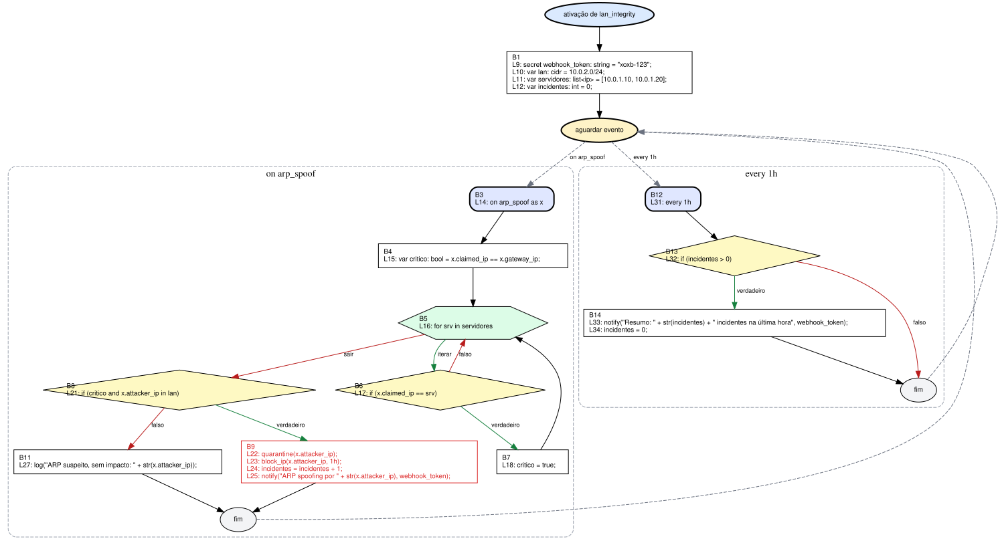

# Sentinela: representações intermédias

**Parte II, tarefa 1.** Implementação em [`cfg.py`](cfg.py), testes em [`test_cfg.py`](test_cfg.py), grafos dos casos práticos em [`cfg/`](cfg/).

## 1. Ponto de partida

O CFG é construído a partir da **árvore sintática do Lark**, a mesma que a gramática de atributos (`sentinela.ag`) valida. Só se constrói o CFG de um playbook **válido**: se a GA encontrar um erro, `construir_cfg` recusa-o. Assim, todas as análises das tarefas seguintes podem assumir que os nomes estão declarados, os tipos estão certos e os segredos não fogem.

A gramática e a GA da Parte I **não foram alteradas**. O construtor percorre a árvore pelas produções da GA, que o LarkAG numera por alternativa (`stmt_4` é a 5.ª alternativa de `stmt`, o `for`, P27).

## 2. Porque é que o CFG da Sentinela não é o de um programa normal

Um playbook não é um programa que começa e acaba: é um **serviço sempre ativo** que reage a eventos (README, §1.2). O CFG tem de representar isso, e não apenas o corpo de cada handler:

| Conceito da linguagem | No CFG |
|---|---|
| Ativação do playbook | nó **início** seguido de um bloco com as declarações do estado (`var`/`secret` do playbook), executado uma vez |
| Espera por eventos | nó **despacho** (`aguardar evento`) |
| `on X as a { … }` | aresta do despacho rotulada `on X` para a **entrada** do handler; a entrada **define** o alias `a` |
| `every T { … }` | aresta do despacho rotulada `every T` para a entrada do handler |
| Fim de um handler | nó **fim**, com uma aresta de volta ao despacho |
| `if (c) { … } else { … }` | nó de **decisão** com arestas `verdadeiro` / `falso`; sem `else`, a aresta `falso` vai para a instrução seguinte |
| `for x in l { … }` | nó de **ciclo** com arestas `iterar` (para o corpo) e `sair`; o fim do corpo volta ao nó de ciclo; o nó **define** `x` |
| Declarações, atribuições e ações | instruções simples, agrupadas em **blocos básicos** |

As arestas do despacho para os handlers e de volta (a tracejado nos desenhos) chamam-se **arestas de serviço**. São elas que mostram que o **estado persiste**: um valor escrito por um handler pode ser lido por outro numa execução seguinte (em `04_arp_spoofing`, `incidentes` é incrementado em `on arp_spoof` e lido e reposto em `every 1h`). A função `sem_servico(g)` remove-as e deixa o fluxo **dentro de uma execução** de cada handler, que é o que interessa, por exemplo, para encontrar ciclos `for` ou código inalcançável num handler.

Não há `while`, `break`, `return` nem chamadas de procedimentos na Sentinela, por isso os únicos ciclos dentro de um handler vêm de um `for` sobre uma lista finita. Isto é intencional: um handler termina sempre.

## 3. Construção

Em duas fases, como nas aulas:

1. **CFG de instruções** (`construir_cfg`): uma instrução por nó. O construtor percorre a árvore e guarda as arestas **pendentes** (origem, rótulo) que ainda não têm destino; cada instrução liga as pendentes a si própria e devolve as novas. Por exemplo, um `if` sem `else` devolve as pendentes do fim do ramo verdadeiro e a aresta `falso` da decisão, e ambas são ligadas à instrução seguinte. Desta forma não são precisos nós de junção vazios.
2. **Blocos básicos** (`blocos_basicos`): um nó é **líder** se não tiver exatamente um predecessor, se o predecessor não for uma instrução simples ou se tiver mais do que um sucessor. Cada líder e as instruções que se lhe seguem em cadeia formam um bloco. Decisões, ciclos, entradas e saídas ficam sozinhos. Os blocos são numerados `B0, B1, …` por uma visita em profundidade (cada handler fica com números seguidos).

O grafo é um `networkx.MultiDiGraph`: um `if (c) { }` vazio tem **duas** arestas (verdadeiro e falso) para o mesmo nó, e um `DiGraph` perderia uma delas.

Cada nó guarda uma lista de `Instrucao` com:

| Campo | Para quê |
|---|---|
| `texto`, `linha` | mostrar e reportar (o texto vem do código-fonte, pelas posições do Lark) |
| `defs`, `uses` | variáveis escritas e lidas: a base para um grafo de fluxo de dados / *reaching definitions* (tarefa 2) |
| `acao`, `destrutiva` | nome da ação chamada; `block_ip` e `quarantine` são destrutivas (como na biblioteca da GA) e aparecem a vermelho |

Em `a.src_ip` a instrução lê a variável `a`; o nome do campo não conta como uso.

Para a análise estática (tarefa 2, [`ANALISE.md`](ANALISE.md)), cada instrução guarda também a árvore da expressão, os argumentos das ações e os nomes visíveis, e o construtor resolve os scopes: uma variável que esconde outra (W03) aparece nos `defs`/`uses` como `nome@L<linha>`.

## 4. Exemplos

| Playbook | Blocos | Arestas | O que se vê |
|---|:-:|:-:|---|
| [`01_port_scan`](cfg/01_port_scan.svg) | 8 | 9 | um `if/else`; os dois ramos juntam-se no fim |
| [`02_brute_force_ssh`](cfg/02_brute_force_ssh.svg) | 8 | 9 | `if` sem `else`: a aresta `falso` vai direta ao fim |
| [`03_syn_flood`](cfg/03_syn_flood.svg) | 11 | 14 | `for` dentro de um `if`, com outro `if` no corpo ([por instrução](cfg/03_syn_flood_instrucoes.svg)) |
| [`04_arp_spoofing`](cfg/04_arp_spoofing.svg) | 16 | 21 | dois handlers (`on` e `every`) que partilham estado através do despacho |



O mesmo grafo em texto (`python cfg.py --texto exemplos/04_arp_spoofing.snt`, excerto):

```
B2 [aguardar evento]  → B3 (on arp_spoof), B12 (every 1h)
B3 [entrada]  → B4
    L14: on arp_spoof as x   defs=['x'] uses=∅
B5 [ciclo]  → B6 (iterar), B8 (sair)
    L16: for srv in servidores   defs=['srv'] uses=['servidores']
B9 [instr]  → B10
    L22: quarantine(x.attacker_ip);   defs=∅ uses=['x']
    L23: block_ip(x.attacker_ip, 1h);   defs=∅ uses=['x']
    L24: incidentes = incidentes + 1;   defs=['incidentes'] uses=['incidentes']
    L25: notify("ARP spoofing por " + str(x.attacker_ip), webhook_token);   defs=∅ uses=['webhook_token', 'x']
```

## 5. Como se verifica

[`test_cfg.py`](test_cfg.py) verifica, para os 4 casos práticos e para todos os playbooks válidos de `testes/`, nos dois níveis (instruções e blocos):

- todos os nós são alcançáveis a partir do início;
- em cada handler, a saída é alcançável a partir da entrada **sem** arestas de serviço, e a saída volta ao despacho;
- cada decisão tem exatamente as arestas `verdadeiro`/`falso` e cada ciclo `iterar`/`sair`;
- os blocos básicos têm exatamente as mesmas instruções que o CFG de instruções, pela ordem do código.

E casos concretos: o `if/else` de `01`, o ciclo de `03` (e a ausência de ciclos em `01`), os eventos do despacho de `04`, o `if` vazio, os `defs`/`uses` de `02` e a recusa de um playbook inválido.

## 6. Uso

```bash
python cfg.py exemplos/*.snt                        # cfg/<nome>.dot e .svg (o .svg precisa do Graphviz: `dot`)
python cfg.py --instrucoes exemplos/03_syn_flood.snt  # uma instrução por nó
python cfg.py --texto exemplos/04_arp_spoofing.snt    # blocos, sucessores, defs e uses no terminal
pytest -q test_cfg.py
```

## 7. Limitações

- O despacho representa **qualquer** ordem de eventos; o CFG não sabe com que frequência chega cada alerta nem que um `every 1h` corre de hora a hora.
- O CFG é **intraprocedimental** por handler; as ações (`block_ip`, …) são instruções atómicas, sem fluxo de controlo próprio.
- Os nomes das alternativas (`stmt_4`, …) vêm da numeração do LarkAG: se a ordem das alternativas em `sentinela.ag` mudar, o construtor tem de ser atualizado (os testes detetam-no).
